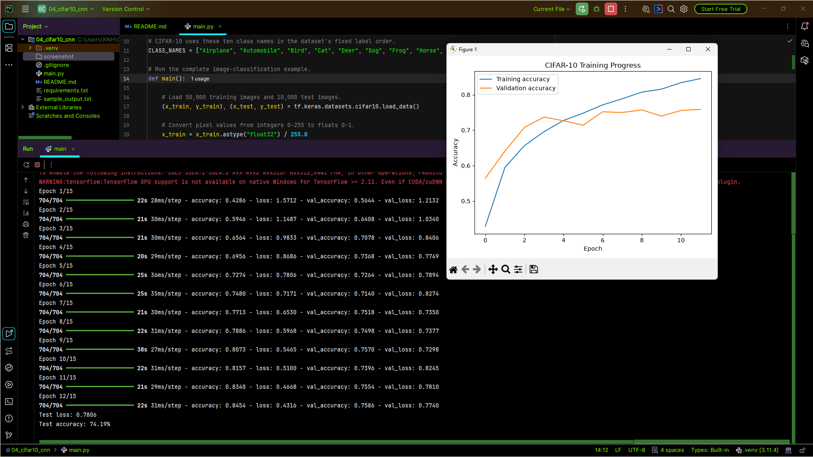

# CIFAR-10 Image Classification with a CNN

This project trains a small **convolutional neural network (CNN)** to classify RGB images into ten categories from the CIFAR-10 dataset. Compared with the MNIST dense network, this project introduces convolution and pooling layers that learn spatial patterns in color images.

## Project Goals

- Work with small color images rather than grayscale digit images.
- Normalize image pixels before model training.
- Build a CNN using convolution, pooling, dense, and dropout layers.
- Monitor validation loss and stop training when validation performance stops improving.
- Evaluate on the separate test set.
- Visualize training progress and inspect one image prediction.
- Save the trained network in Keras format.

## Technology Stack

- **TensorFlow / Keras** — dataset loading, CNN layers, training, early stopping, evaluation, and model saving
- **NumPy** — label shaping and predicted-class selection
- **Matplotlib** — learning-curve and image visualization

## Dataset: CIFAR-10

The script uses `tf.keras.datasets.cifar10`. The dataset contains 60,000 colour images, each 32 × 32 pixels with three RGB channels: 50,000 training examples and 10,000 test examples. Each image belongs to one of ten classes:

`Airplane`, `Automobile`, `Bird`, `Cat`, `Deer`, `Dog`, `Frog`, `Horse`, `Ship`, or `Truck`.

TensorFlow downloads the dataset on the first run if it is not already cached. No custom CSV is required.

## Model Architecture

| Layer / Stage | Purpose |
|---|---|
| Input `(32, 32, 3)` | Accepts a small RGB image. |
| `Conv2D(32)` + max pooling | Learns early visual features and reduces spatial dimensions. |
| `Conv2D(64)` + max pooling | Learns more complex local patterns. |
| `Conv2D(128)` + max pooling | Learns higher-level feature maps. |
| `Flatten` | Converts feature maps into a vector. |
| `Dense(128, ReLU)` | Combines extracted features for classification. |
| `Dropout(0.3)` | Reduces over-reliance on individual neurons during training. |
| `Dense(10, Softmax)` | Outputs probabilities for the ten CIFAR-10 classes. |

## Training Configuration

- **Optimizer:** Adam
- **Loss:** Sparse categorical cross-entropy
- **Metric:** Accuracy
- **Maximum epochs:** 15
- **Batch size:** 64
- **Validation split:** 10% of the training data
- **Early stopping:** monitors `val_loss`, patience of 3 epochs, and restores the best weights

Training can end before the maximum epoch count when the validation loss does not improve for the configured patience period.

## Workflow

1. Load CIFAR-10 training and test sets.
2. Normalize pixel values from `0–255` to `0–1`.
3. Convert label arrays to the expected one-dimensional shape.
4. Build and compile the CNN.
5. Train with validation data and early stopping.
6. Evaluate the restored model on the held-out test set.
7. Print test loss and test accuracy.
8. Plot training and validation accuracy over the training epochs.
9. Predict and display one test image, showing the predicted class.
10. Save the model as `cifar10_cnn.keras`.

## Output and Artifacts

The script prints the test loss, test accuracy, true class of one selected image, predicted class, and model-save confirmation. It also opens Matplotlib windows for the accuracy curve and sample image.

The saved model is `cifar10_cnn.keras`. Exact values depend on the run, random initialization, library version, and hardware; no fixed score is promised.

## Installation and Execution

```powershell
python -m venv .venv
.\.venv\Scripts\Activate.ps1
python -m pip install -r requirements.txt
python main.py
```

The initial run may download CIFAR-10 and take noticeably longer than the MNIST examples. Model training time depends on the computer and whether compatible GPU acceleration is available. CPU execution is supported but can be slower.

## Project Files

| File | Purpose |
|---|---|
| `main.py` | Loads CIFAR-10, trains the CNN, evaluates it, plots progress, displays a sample prediction, and saves the model. |
| `requirements.txt` | Lists TensorFlow, Matplotlib, and NumPy dependencies. |
| `screenshot/output.png` | Screenshot of actual evaluation output, training chart, or prediction. |
| `cifar10_cnn.keras` | Generated trained-model file. |

## Output Screenshot



*Keep the actual screenshot at `screenshot/output.png` relative to this README.*

## Limitations

- CIFAR-10 contains low-resolution images; small details can be difficult to identify.
- The model is a compact learning CNN, not a state-of-the-art image classifier.
- The displayed image is one example and does not provide a complete error analysis.
- Test performance on CIFAR-10 does not guarantee performance on custom images or other image distributions.

## Possible Next Steps

- Add a confusion matrix and per-class precision/recall.
- Display several incorrect predictions for error analysis.
- Compare a few model sizes or data-augmentation settings.
- Add a separate script that loads the saved Keras model and predicts an image.

**Project level:** Junior · Deep Learning · CNN · Computer Vision Fundamentals

# Moe Htet Ar Kar (Phoe Cho)